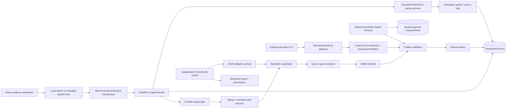

# Architecture and invariants

The baseline graph has three fixed nodes and no agent-selected tools. The UI uses durable jobs with fenced leases, cancellation and atomic publication. A synchronous baseline API also remains available. The worker executes a trusted child process under a deadline; it is not an arbitrary-code sandbox.

The separate model CLI/library selects exact excerpts and provisional evidence relations through validated structured output. It reserves token/cost budgets and journals ambiguous billing before another invocation. The optional model path also runs through durable jobs when enabled by the operator. Admission pins model settings, and paid failures are terminal rather than automatically retried. Restricted live diagnostics have run; their reports are separate from the controlled-response tests. Semantic retrieval runs pinned CPU embeddings with token-aware source chunks and rank fusion. The optional persistent library reuses source-aware pgvector corpora; the default workbench continues its extractive baseline.

Every requirement retains the exact source span. Every evidence reference carries the source content hash. References are validated against the immutable documents before persistence. Documents are not editable in place: a changed input is a new analysis. Idempotency binds a tenant's request key to a canonical input fingerprint.

Reviews update a separate row using a version predicate inside the same transaction as the audit insert. A stale version fails without writing a review or audit event. An approved evidence review does not turn the draft into a finalized contract response. Missing and conflicting evidence block approval.

The independent evaluation package invokes a trusted selected adapter in a fresh deadline-bound process; it does not import ATLAS into the judge or use its extraction functions to build expected labels. The adapter receives JSON input copies without labels; arbitrary trace fields are excluded from public reports. Report publication is atomic and refuses non-finite metrics. Citation scoring reconstructs hashes/spans independently. Synthetic labels are authored in `datasets/golden.json`, and the adapter never receives them.

Current persistence uses a JSON snapshot for each analysis and normalized review/job/audit rows. This keeps source snapshots immutable but is not the final large-document schema. SQLite transactions and recovery are verified locally. PostgreSQL concurrency, frozen normalized document/chunk migrations and exact-search persistent pgvector retrieval have now been locally executed and verified. Forced row policies and restricted API/worker role behavior are locally verified. Production role provisioning, object storage and deployed validation remain incomplete. The persistent library uses exact cosine search; approximate indexes are not claimed.

Opt-in OpenTelemetry exports allowlisted metadata to private process-local files. Documents, prompts, credentials and exception events are excluded. Cross-process parent propagation and cloud trace ingestion remain incomplete.

Optional managed authentication verifies an explicitly pinned resource-access-token profile and resolves active server-owned workspace membership on every request. Development token fallback is disabled in managed mode. Real Cognito reviewer login has been verified locally; deployed identity validation remains unfinished. Provider refresh tokens are discarded. Local bearer mode goes directly to its configured identity; the membership registry applies to managed mode.

An explicit browser-session factory option adds authorization-code callbacks and a bounded process-local session registry. Provider tokens stay on the server; browser cookies carry opaque handles. Origin/CSRF checks protect cookie-authenticated writes, while token trust and server-owned memberships are still checked on each API request. Default launchers and the public lab do not enable this option. The workbench sign-in interface and composed synthetic TLS/browser flow have passed controlled acceptance. The explicit operator factory and public provider checks are described in the [managed-login guide](managed-login-development.md). Real provider acceptance and a multi-instance session strategy remain unfinished.
